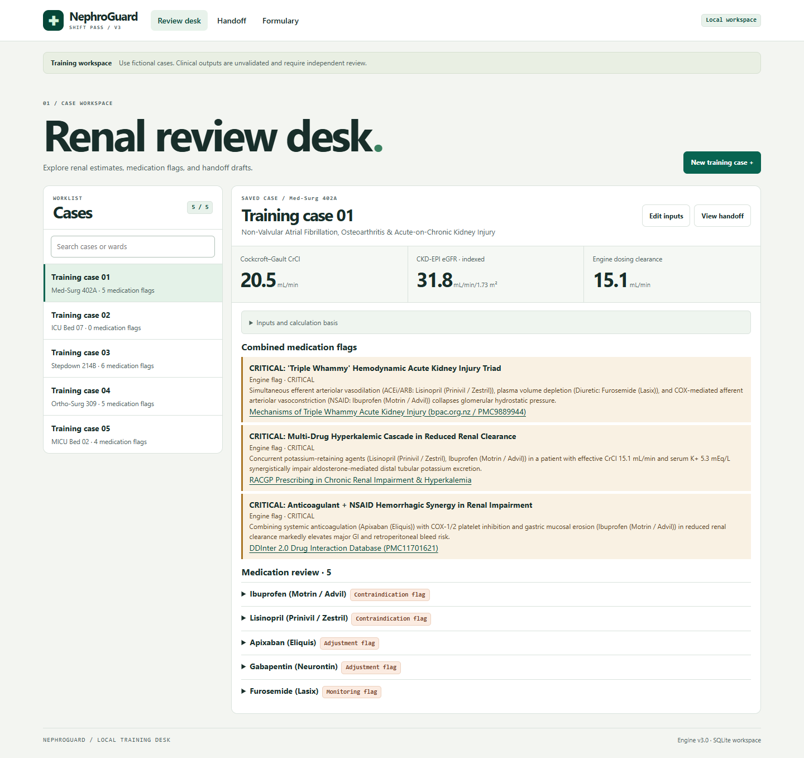

# NephroGuard & ShiftPass

A local training workspace for exploring the bundled renal review engine. The browser desk includes a searchable case list, an input editor, medication flags and linked references, I-PASS drafts, multilingual handout examples, and sample FHIR-shaped JSON exports.



## Run locally

Use Python 3.12 or newer. From the repository directory, run:

```powershell
py -3.12 server.py --db nephroguard-demo.db
```

Open [the local desk](http://127.0.0.1:8765/). A new database initializes five bundled training vignettes with generic case labels. Preview an edited case before saving it, or open **Handoff** to inspect and export training artifacts. The Python standard library is sufficient.

On systems that use `python3`, replace `py -3.12` with `python3`. To inspect the bundled formulary from the CLI, run `py -3.12 cli.py formulary`. The CLI uses the original default database path, while the browser command above uses an explicit demo database.

## Verification

```powershell
py -3.12 -m unittest discover -s tests -v
py -3.12 -m compileall -q .
node --check assets/app.js
```

The HTTP and SQLite tests exercise the default UI, all five sample cases, invalid and cross-origin requests, consistent saved IDs, decoded lookups, a handoff log round-trip, and persistence across restart. Edge browser checks covered case search, edit and preview, save and reload, creating a training case, medication filtering, language selection, logging a draft, and both export downloads. Reflow was checked at 320, 390, 768 and 1440 px. Automated axe checks on desktop, mobile, the editor, and handoff found zero violations in the selected WCAG A and AA rules.

## Scope

This project uses a local development HTTP server without user accounts. Use fictional inputs and keep the server on loopback. SQLite databases, generated patient data, and exports belong outside version control. The calculation and dosing rules are the supplied engine implementation. Clinical accuracy, translation accuracy, and FHIR conformance require separate validation. Keep generated artifacts outside clinical systems. [Python HTTP server guidance](https://docs.python.org/3/library/http.server.html) · [HL7 FHIR Bundle reference](https://hl7.org/fhir/R4/bundle.html)
